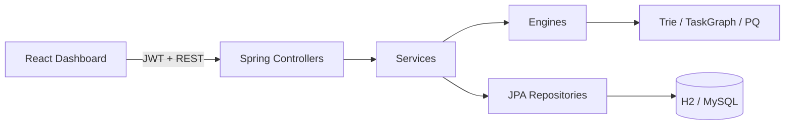
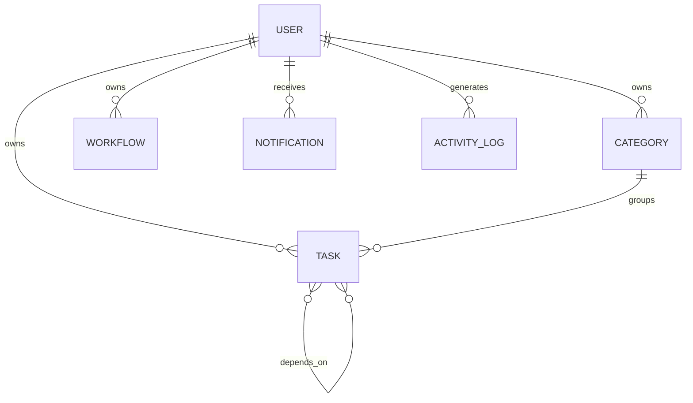

# FlowForge — Smart Task Scheduler & Workflow Automation Engine

Capstone project: a multi-tier task scheduler with JWT auth, custom DSA (Trie, DAG, KMP, merge/quick sort, sliding window), design patterns (Command, Builder, Observer-style workflows), and a React dashboard.

## Stack

| Tier | Tech |
|------|------|
| Frontend | React 19, Vite, TypeScript, Tailwind CSS v4, Axios, Recharts, React Router |
| Backend | Java 21, Spring Boot 3.3, Spring Security + JWT, JPA |
| Database | H2 (default/dev) · MySQL (prod profile) |

## Quick start

### Prerequisites

- Java 21+
- Node.js 20+
- Maven 3.9+ (a local copy is included under `apache-maven-3.9.6/`)

### 1. Start the backend

```powershell
cd backend
..\apache-maven-3.9.6\bin\mvn.cmd spring-boot:run
```

- API: http://localhost:8080  
- Swagger: http://localhost:8080/swagger-ui.html  
- H2 console: http://localhost:8080/h2-console  
  - JDBC URL: `jdbc:h2:mem:schedulerdb`  
  - User: `sa` · Password: *(empty)*

**Seeded demo user:** `admin` / `password`

### 2. Start the frontend

```powershell
cd frontend
npm install
npm run dev
```

Open http://localhost:5173 — Vite proxies `/api` to the backend.

### Docker (optional)

```powershell
docker compose up --build
```

- App UI: http://localhost:3000  
- API: http://localhost:8080  

## Architecture



### Domain UML (simplified)



### Key modules

- **SchedulerEngine** — recurrence / cron scheduling  
- **PriorityQueueManager** — priority-ordered execution  
- **WorkflowEngine** — observer-style automation on task completion  
- **CommandStack** — undo/redo for create/update/delete  
- **TrieSearchManager + KMP** — title/tag/description search  
- **TaskGraph** — cycle detection + Kahn topological sort  

## REST API (summary)

| Area | Endpoints |
|------|-----------|
| Auth | `POST /api/auth/register`, `POST /api/auth/login` |
| Tasks | `GET/POST /api/tasks`, `PUT/DELETE /api/tasks/{id}`, archive/restore/complete, undo/redo, topological |
| Categories | `GET/POST /api/categories`, `DELETE /api/categories/{id}` |
| Workflows | CRUD + `POST /api/workflows/{id}/toggle` |
| Notifications | `GET /api/notifications`, `POST /api/notifications/{id}/read` |
| Analytics | `GET /api/analytics` |
| Reports | `GET /api/reports/export?format=csv\|pdf\|excel\|json` |
| Logs | `GET /api/logs?limit=50` |

Task listing supports `?query=` (Trie/KMP search) and `?sortBy=priority|dueDate|title` (custom merge/quick sort).

## Profiles

- **dev (default):** in-memory H2, auto-seed  
- **prod:** MySQL via `application-prod.properties`  

```powershell
..\apache-maven-3.9.6\bin\mvn.cmd spring-boot:run "-Dspring-boot.run.profiles=prod"
```

## Tests

```powershell
cd backend
..\apache-maven-3.9.6\bin\mvn.cmd test
```

## Docs

- [`DatabaseSchema.sql`](DatabaseSchema.sql) — DDL  
- [`walkthrough.md`](walkthrough.md) — demo script  
- [`docker-compose.yml`](docker-compose.yml) — multi-container deploy  

## Project layout

```
capstone/
├── backend/          Spring Boot API + engines + DSA
├── frontend/         React dashboard (FlowForge)
├── DatabaseSchema.sql
├── docker-compose.yml
├── README.md
└── walkthrough.md
```
